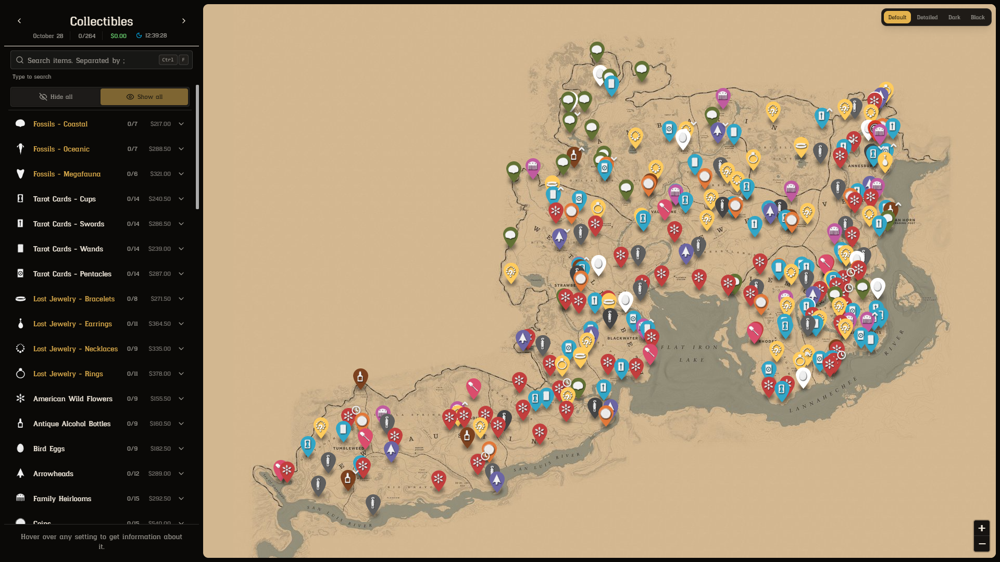

<h1 align="center">RDR2 Collectors Map</h1>

  A map for Red Dead Online. Find all collectibles in one place.

  

  <a href="https://TariQ-2.github.io/RDR2CollectorsMap/"><strong>Live Website</strong></a>

  
  
  
  
  
  

  
  
  
  
  
  
  
  
  

---
